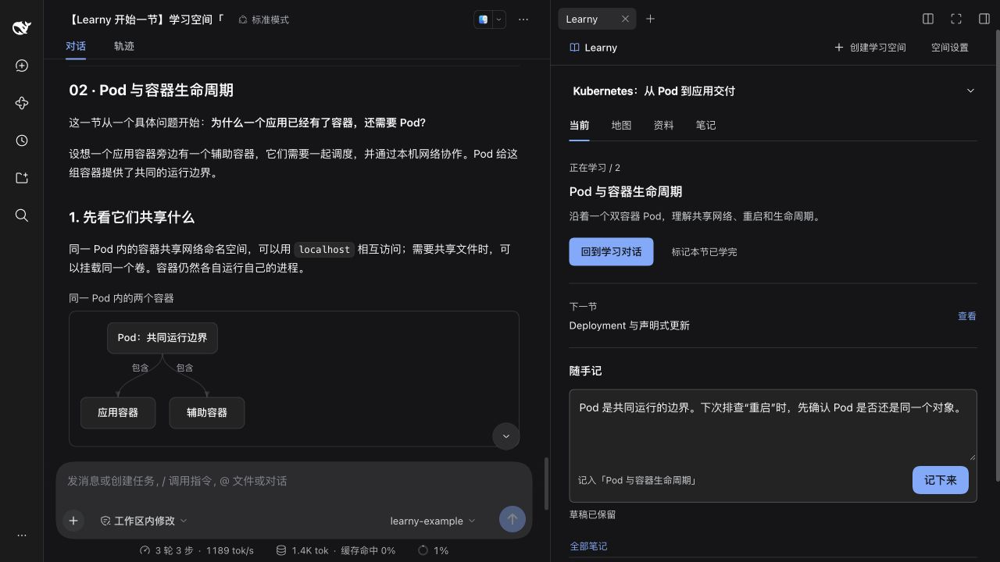
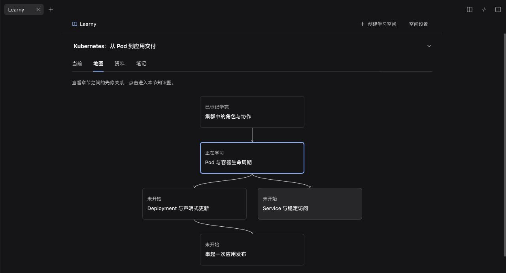
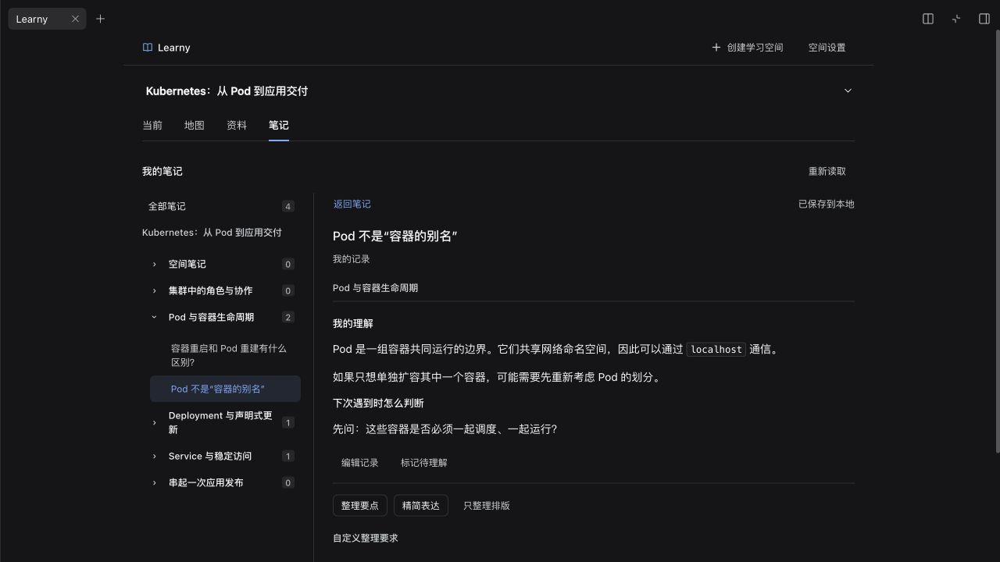
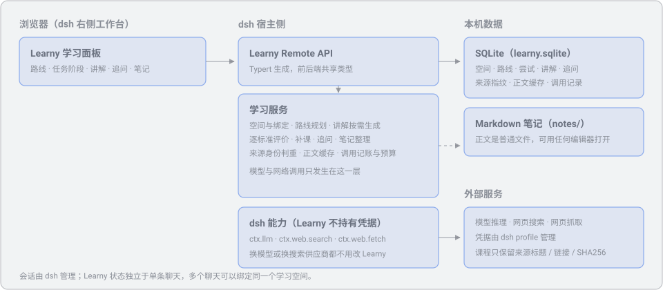

<p align="center">
  <picture>
    <source media="(prefers-color-scheme: dark)" srcset="docs/assets/logo-dark.svg">
    
  </picture>
</p>

<p align="center"><b>在对话中学习，把理解留在自己的学习空间。</b></p>

<p align="center">
  <a href="LICENSE"></a>
  
  
  
</p>

Learny 是 [dsh](https://www.npmjs.com/package/@deepseek-ai/dsh)（DeepSeek Harness）的学习插件。给它一个项目目录或知识主题，以及你的学习目标和已有基础，它会结合材料规划章节和先修关系。你在 dsh 对话中阅读讲解、追问和验证，在右侧 Learny 面板里管理进度、资料与笔记。

**dsh 承担实时教学，Learny 留下学习结构和自己的理解。** 想到什么就先记下来，笔记按章节归档；需要时再整理表达、回忆知识，或带着笔记回到对话继续问。



> 截图基于 Learny 0.1.5 / dsh 0.2.1-rc.2 的实际界面（2026-10-27）。课程、笔记与示例讲解为预置的 Kubernetes 演示内容，用于展示交互，不代表一次真实联网生成的结果。

## 可以用它做什么

| 你想做的事 | Learny 提供的帮助 |
|---|---|
| 接手陌生项目，不知道从哪里读起 | 从指定目录选取源码、配置与文档，围绕学习目标生成章节路线 |
| 系统补齐 Kubernetes、消息队列等基础 | 通过 dsh 搜索和读取网页资料，规划主题课程，在对话里用中文逐步讲解 |
| 学到一半有疑问，想继续深入 | 直接在同一个 dsh 对话追问，沿用宿主的模型、工具和上下文 |
| 想记住内容，又不想花时间排版 | 使用「随手记」，或把一条已完成的模型回答「收进笔记」，再按需要整理 |
| 过段时间想回顾，或忘了当时哪里没懂 | 按章节找笔记，筛选「待理解」，先回忆再展开内容，也能带着笔记继续提问 |

实践与验收可以按需打开。阅读教程不要求先写猜想，也不要求先完成练习。

## 一个空间，四个入口

| 入口 | 主要操作 |
|---|---|
| **当前** | 继续本节、回到学习对话、标记学完、随手记 |
| **地图** | 看章节先修关系或课程目录，进入本节知识图，按需打开实践与验收 |
| **资料** | 查阅课程来源，查看资料关联了哪些章节 |
| **笔记** | 按空间与章节查找、阅读、编辑、整理和复习自己的记录 |

### 学习地图：知道下一步，也看得见全局

全景图展示建议的先修关系，也可以切换成章节目录。点击章节后查看本节的知识图、学习目标和记录；已有基础的部分可以跳学。自己标记的「已学完」与实践评价分别记录。



### 笔记：先留下内容，再整理表达

随手记无需先起标题、建目录或选择格式，使用 `⌘ / Ctrl + Enter` 保存。开始一节后，记录会关联到本会话的学习章节；也可以手动调整归属。宽面板展示章节目录树，窄面板按需展开目录。

整理时可选择「整理要点」「精简表达」「只整理排版」，或输入自己的要求，先看预览再采用，保留原文与整理记录。复习时先尝试回忆，再展开笔记对照；还不确定的内容可以标记为「待理解」。



### 教程：图解和自测就在对话正文里

讲解按章节、小节和段落展开，可以在文字之间穿插结构图、流程图、自测与要点块。图前图后都能继续解释，不需要另开文件查看。资料依据放在章末可展开的「本章依据」中。

这些教学块按内容需要使用，不固定数量，也不把自测设为继续阅读的门槛。生成质量取决于所用模型与资料，需要核实的实现细节仍应对照源码或原始文档。

## 快速开始

需要 **Node.js 24+、pnpm，以及已经能正常对话的 dsh 0.2.1-rc.2**。Learny 0.1.5 的兼容声明针对这个宿主版本；其他版本需要另行验证。

当前通过源码构建安装，**不需要先打包成 tgz**。在终端执行：

```sh
git clone https://github.com/Magic-lem/learny.git
cd learny
pnpm install --frozen-lockfile
pnpm build

dsh plugin --profile web add "link:$PWD/packages/learny"
dsh web
```

如果 dsh 已在运行，安装后重启并刷新页面。在右侧工作台新建标签页，选择 **Learny**。已有模型与搜索配置直接复用；没有配置过 dsh 时，先按 [安装与使用](docs/install-and-use.md) 完成配置。

主题课程需要 dsh 的网页搜索与抓取能力。默认可以使用 dsh 内置的 DeepSeek 搜索，凭据在 dsh 中配置。本仓库的 OneAPI 搜索适配器是可选项，安装 Learny 本体不需要它。

`link:` 安装依赖本地源码与构建目录，请保留它们。更新代码后重新运行 `pnpm build`，重启 dsh 并刷新页面。需要固定版本或迁移安装内容时，可运行 `pnpm pack:plugin`，再安装生成的 `artifacts/dsh-plugin-learny-<版本>.tgz`。

> 当前分发方式是 GitHub 源码构建，尚未发布 npm 包或 GitHub Release 安装附件。旧 `v0.1.4` 标签不包含最新功能，试用当前版本请使用 `main`，需要复现安装时记录实际提交。

## 第一次学习

1. **创建空间**：选择项目或主题，填写想学什么、已有基础与目标；项目学习再指定本地目录。
2. **生成路线**：项目路线基于本地材料规划，主题路线先检索资料。生成后到「地图」查看章节。
3. **开始一节**：在「当前」或章节页点击「在对话里开始这一节」，到原生 dsh 对话阅读和追问。
4. **留下理解**：在「随手记」写自己的想法，或在模型回答操作区点击「收进笔记」。
5. **整理与回顾**：到「笔记」按章节查找、整理、复习；遇到疑问，带着笔记发回对话。

「空间设置」可以修改目标、检查宿主能力。能力检查反映宿主是否挂载相关能力，实际调用是否可用还取决于模型、凭据和网络配置。

## 数据与配置

Learny 在本地 dsh 宿主中运行，无需部署 Learny 云端服务。模型、搜索供应商和凭据沿用 dsh profile。

```text
<dataDir>/
├── learny.sqlite   # 空间、路线、关联记录、来源、研究缓存与调用记账
├── notes/         # Markdown 笔记
└── revisions/     # 笔记历史快照
```

默认安装配置将数据放在 dsh 主目录的 `learny/` 下，可通过 `LEARNY_DATA_DIR` 或插件 `dataDir` 调整。对话及其消息由 dsh 管理，Learny 保存会话关联；多个会话可以绑定到同一个学习空间。

本地存储不等于离线推理：规划路线、生成讲解、整理笔记和搜索资料时，相关内容会发送给你在 dsh 配置的模型或网页服务。主题课程保留来源标题、链接与内容指纹；网页正文可在本地研究缓存中短期复用。

| 常用参数 | 默认值 | 用途 |
|---|---|---|
| `maxOutputTokens` | `8192` | Learny 发起的单次模型调用输出上限 |
| `timeoutMs` | `60000` | Learny 发起的单次模型调用超时，单位毫秒 |
| `researchDailyCallBudget` | `60` | 每个空间滚动 24 小时的研究搜索与抓取调用上限 |
| `researchPageCacheTtlDays` | `30` | 已读取网页的研究缓存复用期限 |

研究预算用于 Learny 的资料收集流程；dsh 原生对话中的工具调用由宿主管理。完整说明见 [配置](docs/configuration.md)。

## 工作原理

浏览器中的学习面板通过 Remote API 调用本机学习服务，管理空间、路线、笔记与记录。开始章节时，学习任务和资料发送到 dsh 原生会话，由宿主 Agent 讲解并处理后续交流。



## 文档与开发

- [安装与使用](docs/install-and-use.md)：安装、模型与搜索配置、开始学习。
- [配置](docs/configuration.md)：dsh 能力和 Learny 插件参数。
- [架构](docs/architecture.md)：模块边界、教学联动与数据流。
- [设计系统](docs/design-system.md)：界面规范。
- [维护者笔记](docs/internal/)：产品设计与实现记录。

```sh
pnpm build         # 编译宿主端、生成 Remote 类型、打包浏览器端
pnpm typecheck
pnpm test
pnpm pack:plugin   # 生成 Learny 与可选搜索适配器的安装包
```

`packages/learny` 是插件本体，`packages/web-search-oneapi` 是可选搜索适配器。Web 宿主已验证，Desktop 原生窗口尚未验证。目前面向单用户本地使用，未提供账号体系、跨设备同步或定时复习提醒。

## 许可

[MIT](LICENSE) © 2026 Magic Lem
