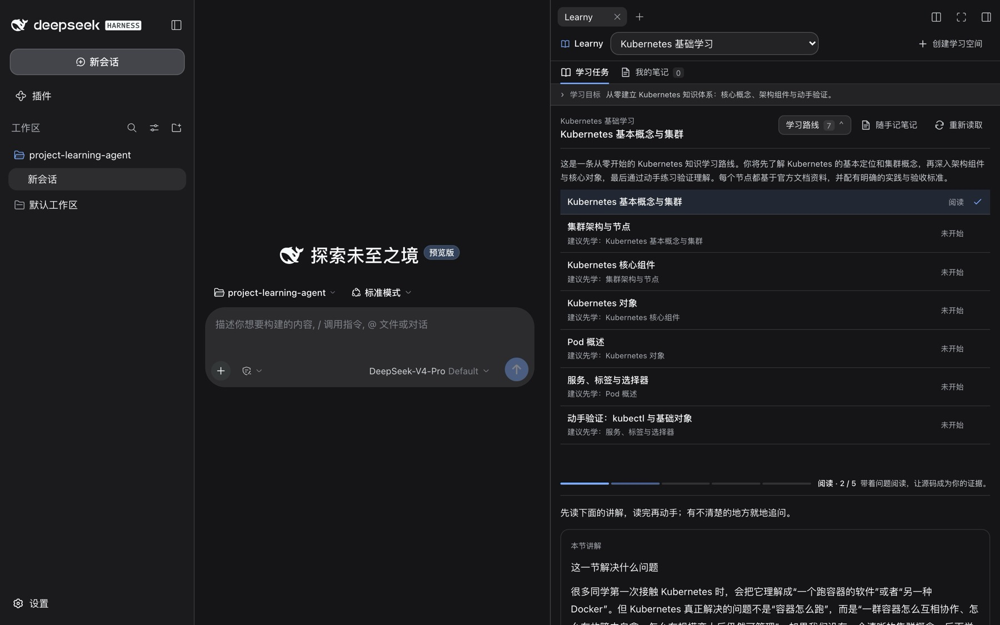
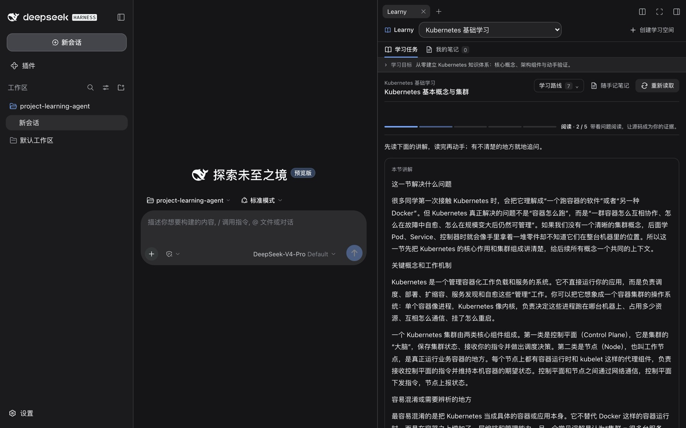

<p align="center">
  <picture>
    <source media="(prefers-color-scheme: dark)" srcset="docs/assets/logo-dark.svg">
    
  </picture>
</p>

<p align="center"><b>把「我大概懂了」变成「我能说明白」。</b></p>

<p align="center">
  <a href="LICENSE"></a>
  
  
  
</p>

Learny 是一个跑在 [dsh](https://www.npmjs.com/package/@deepseek-ai/dsh)（DeepSeek Harness）右侧工作台的学习插件。给它一个真实项目目录，或者一个知识主题，它会去查资料、写成中文讲解、排出一条能动手验收的学习路线；你每学完一节，留下的判断、实践证据和自己的解释都保存在本机。

它解决的是"用 AI 总结完就忘"这件事：总结替你读完了，但没替你学会。Learny 的顺序是**先自己判断，再看讲解，然后动手，最后用自己的话解释**，每一步都留下可以复查的痕迹。

```
判断  →  讲解  →  实践  →  解释  →  验收
你觉得会发生什么   这一节到底在讲什么   真的跑一遍   用自己的话说清楚   逐条对照标准
```

## 它适合谁

| 场景 | Learny 做什么 |
|---|---|
| 接手一个陌生项目 | 读取仓库目录，按结构与调用链排出一条源码学习路线，节点直接指向真实文件和命令 |
| 补齐一块基础知识（K8s、消息队列、分布式事务…） | 搜集官方资料，写成中文讲解，按"概念 → 机制 → 易错点 → 动手验证"组织 |
| 准备面试或项目复盘 | 每一次实践与解释都留档，后续可以继续整理成项目总结与面试表达 |
| 看英文文档太累 | 网页只作为素材：产出的是中文讲解，原文不保存，只留来源链接与内容指纹 |

## 主要能力

- **两种学习空间**：项目空间只使用你指定的本地目录作为材料；主题空间先搜索资料再规划路线。
- **可验收的学习路线**：3–8 个节点，每节都有导读、阅读要点、实践类型和验收标准，节点之间带先修关系。
- **中文讲解，按需生成**：进入某节的阅读阶段时才写这一节的讲解，写完缓存；资料更新可以重写。你不必读原始网页。
- **实践按任务类型记录**：执行命令、写配置、对比两种做法、做方案取舍，各给对应的记录栏，而不是一个万能文本框。
- **逐标准评价**：提交后按验收标准逐条给出结论，指出证据与缺口，不足时给出有限的补课任务，需要时可以换一个条件重练。
- **继续深究**：就某一节提问默认发到左侧对话里，由对话中的模型带着本节资料回答；也可以只在面板里追问，或选中讲解里的某一段直接追问那一段。
- **本地 Markdown 笔记**：随时记录、查找、按你的意图整理成新版，原文与整理版本都能恢复。
- **联网可计量**：搜索与抓取有来源判重、正文缓存和滚动 24 小时预算，超预算会停下而不是反复付费。

## 产品预览

装在 dsh 里之后，左边照常和模型对话，右边是当前学习空间：一条有关联关系的学习路线，加上你正在做的那一节。



打开某一节时，先读这一节的中文讲解，再动手；讲解里推荐顺着「问题 → 机制 → 易错点 → 与实践的关系」读，有不清楚的地方就地追问，也可以选中某一段单独深究。



## 快速开始

Learny 只提供一个插件包；模型和网页搜索用的是 dsh 自己的能力，其中搜索由 dsh 内置的 DeepSeek 搜索提供，配一个 API Key 即可。

需要 Node.js 24+、pnpm，和一个已经能对话的 dsh：

```sh
# 1. 拿到插件并构建（插件以 lib/ 为入口，源码需要先 build 一次）
git clone https://github.com/Magic-lem/learny.git
cd learny
pnpm install --frozen-lockfile
pnpm build

# 2. 装进 dsh 的 web profile（dsh 会自动把它落成 profile）
dsh plugin --profile web add link:$PWD/packages/learny

# 3. 模型按你自己的服务填，搜索用 dsh 内置的 DeepSeek 搜索
export LEARNY_MODEL_URL='https://your-gateway/v1'
export LEARNY_MODEL_KEY='...'
export LEARNY_MODEL_ID='your-model-id'
export DEEPSEEK_API_KEY='...'

# 4. 启动，用终端打印的带 token 的地址打开
dsh web --patch ./examples/dsh-model.patch.yml
```

`dsh plugin add` 就是在该 profile 里执行 `pnpm add`，所以来源可以是：源码目录 `link:$PWD/packages/learny`（改完 `pnpm build` 即生效）、打包产物 `./artifacts/dsh-plugin-learny-0.1.4.tgz`（`pnpm pack:plugin` 产出，适合分发和固定版本）、或发布到 npm 后的包名。装进 `web` 就是装进你日常用的那个 dsh；想隔离出一份独立 profile 时，把 `web` 换成你自己的 profile 名即可。完整步骤见 **[安装与使用](docs/install-and-use.md)**。

第一次打开时，Learny 顶部会做一次能力自检（模型 / 网页搜索 / 网页抓取）。项目空间只用本地材料，主题空间才需要搜索。

## 配置

模型、网页搜索和插件参数都写在 dsh profile 里，Learny 自己不保存任何 endpoint 与密钥。常用的几个插件配置：

| 配置 | 默认 | 作用 |
|---|---|---|
| `dataDir` | 必填 | 学习数据目录（`learny.sqlite` 与 `notes/`） |
| `maxOutputTokens` | `8192` | 单次模型输出上限，节点多或讲解更长时可调大 |
| `researchDailyCallBudget` | `60` | 每个空间滚动 24 小时的搜索+抓取上限 |
| `researchPageCacheTtlDays` | `30` | 已读网页正文的复用天数 |
| `timeoutMs` | `60000` | 单次模型调用超时 |

模型和搜索都属于 dsh profile，Learny 不保存任何 endpoint 与密钥。完整说明与示例：[配置](docs/configuration.md)。

## 数据与隐私

- 所有学习数据都在本机：`<dataDir>/learny.sqlite` 存学习空间、路线、尝试、讲解、追问与调用记账，`<dataDir>/notes/` 存 Markdown 笔记。
- 联网只发生在三类调用：模型推理、网页搜索、网页抓取。凭据由 dsh 管理，Learny 不接触。
- 学习产物里**不保存网页正文**，只保留来源标题、链接与 SHA256；正文只短期留在研究缓存中，用于生成讲解与回答追问。
- 搜索与抓取按来源判重、复用缓存、受每日预算约束，宁可停下也不会重复付费。

## 它是怎么工作的

Learny 是一个 dsh 插件，由三部分组成：浏览器里的学习面板（React）、宿主侧的学习服务（Remote API + 领域状态机）、以及本机的 SQLite 持久化。模型、搜索、抓取都通过 dsh 暴露的能力调用，所以换模型或换搜索供应商都不需要改 Learny。


细节见 **[架构](docs/architecture.md)**，早期架构图见 [architecture/](architecture/)。

## 文档

- [安装与使用](docs/install-and-use.md)：从零装好并生成第一条学习路线。
- [配置](docs/configuration.md)：模型、网页搜索、插件参数。
- [架构](docs/architecture.md)：模块边界、数据流与联网边界。
- [设计系统](docs/design-system.md)：颜色、字号、组件规范。
- [维护者笔记](docs/internal/)：产品设计、里程碑与实现记录，面向本仓库的维护者，不是使用说明。

## 开发

```sh
pnpm install --frozen-lockfile
pnpm build         # 编译 Host、生成 Remote 类型、打包浏览器端
pnpm typecheck
pnpm test          # 38 项，覆盖学习流程、搜索适配器、抓取记账与缓存
pnpm pack:plugin   # 产出 artifacts/ 下的两个插件包
pnpm demo:install && pnpm demo:web   # 本地起一个 demo 宿主
```

仓库结构：`packages/learny` 是插件本体（唯一的必需品），`packages/web-search-oneapi` 是可选适配器——把没有内置搜索、但能返回结构化来源的 OpenAI/Anthropic 兼容网关接成 dsh 的搜索 provider，不用它时删掉该目录也不影响 Learny。`examples/` 是 dsh profile overlay 示例，`tests/` 是自动化检查，`architecture/` 是架构图。

## 状态与限制

- 宿主基线是 `dsh@0.2.0-rc.2`（预发布版本），插件声明的兼容范围以此为准；升级 dsh 前先看 [维护者笔记里的基线说明](docs/internal/runtime-baseline.md)。
- 面向单用户、本地优先：没有服务端、没有账号体系，多人共用一台机器请各自使用独立 `dataDir`。
- Web 宿主已实际验证；Desktop 原生窗口尚未验证。
- 讲解、评价、追问都依赖模型，输出质量取决于你配置的模型；讲解质量不达标可以重写某节，或换一个模型再试。

## 许可

[MIT](LICENSE) © 2026 Magic Lem
