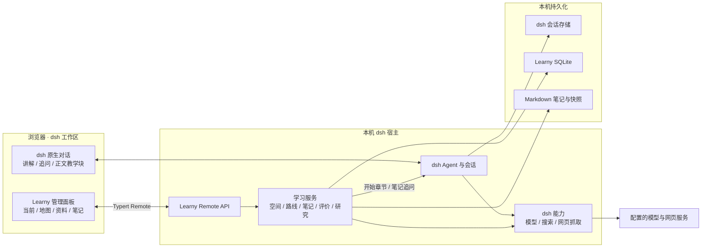
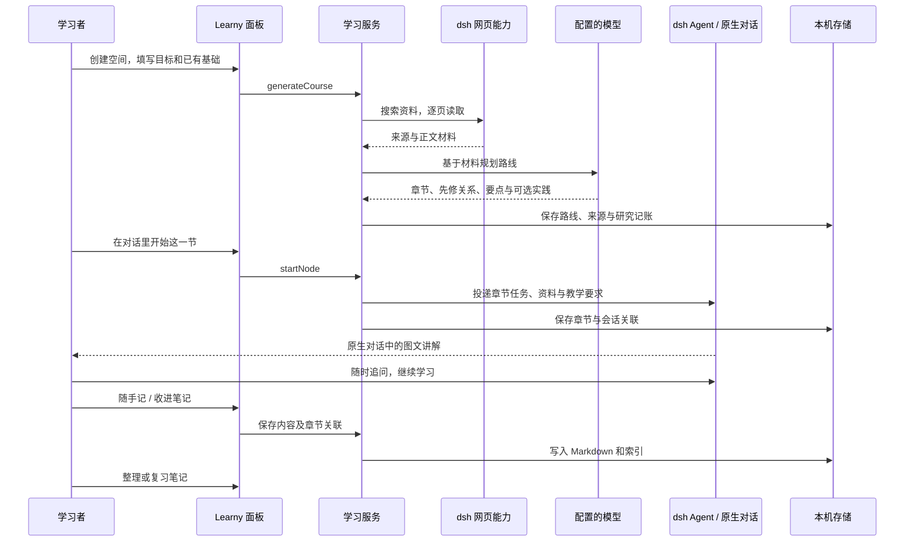

# 架构

Learny 在本机 dsh 宿主中运行。dsh 原生对话负责实时讲解、工具使用与追问；Learny 管理学习空间、路线、材料、笔记和记录。模型、搜索供应商与凭据由 dsh 配置。

## 组成



| 部分 | 位置 | 职责 |
|---|---|---|
| 管理面板 | `packages/learny/src/client/` | 当前章节、路线地图、资料、笔记、学习与实践记录 |
| 对话联动 | `packages/learny/src/host/chat.ts` 与客户端桥接 | 投递章节任务与笔记问题、读取宿主已完成的回答、收录笔记 |
| 正文教学块 | `packages/learny/src/client/fence.tsx` | 在对话正文呈现图解、自测、要点与章末依据 |
| 学习服务 | `packages/learny/src/core/` | 路线规划、可选实践评价、笔记整理、研究缓存与预算 |
| 宿主适配 | `packages/learny/src/host/` | Remote API、模型网关、SQLite 运行时与生命周期 |
| 存储 | `packages/learny/src/storage/` | 领域表结构与 Markdown 文件读写 |
| 搜索适配器 | `packages/web-search-oneapi/` | 可选：把兼容网关接成 dsh 的搜索 provider |

前端通过 Remote API 访问本机服务。dsh 会话保存消息正文；Learny 保存空间绑定、章节任务与关联记录，不在管理页复制实时对话。

## 一次主题学习的数据流



项目路线从用户指定目录选取源码、配置与文档；主题路线通过网页能力收集材料。原生对话中的 Agent 可以按教学任务使用宿主工具核实实现或补齐原理。

## 正文教学块

教程以 Markdown 为主，可以在任意段落之间穿插 `learny` 围栏，载荷为 JSON：

- `diagram`：结构图或流程图。
- `quiz`：可跳过的即时自测。
- `note`：要点块。
- `sources`：章末默认折叠的「本章依据」，使用可读标题、地址与支持说明。

当前宿主未提供对应的围栏渲染扩展点，客户端在输出完成后识别并接管 Learny 载荷；解析失败保留原始代码块。正文桥接依赖宿主 DOM 结构，升级宿主时需要验证。历史消息不批量改写，新教学任务要求把内部来源编号留在追踪数据中。

## 笔记

随手记保存原始内容并推导标题；开始章节后按本会话的章节归档，也允许手动移动。收录模型回答时读取宿主已完成的消息，以消息标识去重，并保存会话和消息来源。

整理先生成可预览的修订，再由用户采用；原始内容、修订和版本冲突分别记录。复习采用「先回忆、再展开笔记对照」的交互，结果由用户自评，未提供定时提醒。

## 数据与联网边界

```text
<dataDir>/
├── learny.sqlite   # 空间与绑定、路线、章节任务、评价、修订索引、来源与研究缓存
├── notes/         # Markdown 笔记正文
└── revisions/     # 历史快照
```

笔记正文是普通文件，可以在外部编辑器打开。写入时检查版本，避免过期编辑覆盖外部修改。升级前应在宿主停止后备份整个数据目录。

主题课程记录保存来源标题、链接和内容指纹；网页正文在研究缓存中按期限复用。来源 URL 和正文指纹用于去重，搜索与抓取在调用前记账，每个空间受滚动 24 小时预算约束。该预算覆盖 Learny 的研究流程，原生 dsh 对话的工具调用由宿主管理。

模型推理、网页搜索和抓取会把相关内容发送给配置的服务。本地存储不意味着离线推理；Learny 不提供独立云端服务、账号体系或跨设备同步。多用户应使用各自的数据目录。

宿主兼容基线见 [运行时说明](internal/runtime-baseline.md)。早期模块草图见 [architecture/](../architecture/)，其中的旧交互不代表当前界面。
