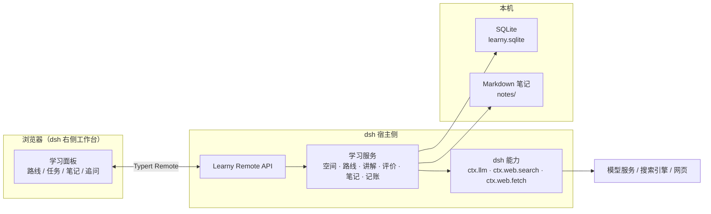
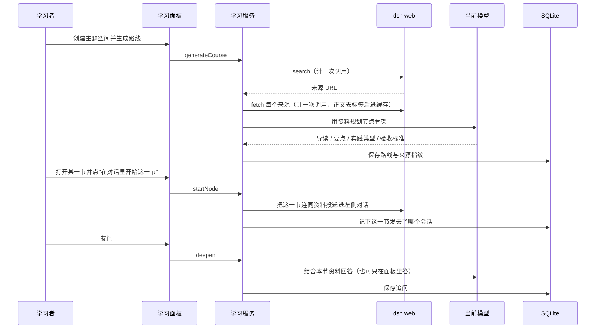

# 架构

Learny 是一个 dsh 插件：它不自己接模型、不自己管凭据，只消费 dsh 暴露的能力，把学习过程中的状态存在本机。

## 组成



| 部分 | 位置 | 职责 |
|---|---|---|
| 学习面板 | `packages/learny/src/client/` | 工作台界面：路线地图、任务各阶段、笔记、追问、历史尝试 |
| 学习服务 | `packages/learny/src/core/` | 业务规则：空间、路线规划、讲解、评价、笔记整理、研究记账 |
| 宿主适配 | `packages/learny/src/host/` | Remote API、模型网关、SQLite 运行时与生命周期 |
| 存储 | `packages/learny/src/storage/` | 领域表结构与 Markdown 文件读写 |
| 搜索适配器 | `packages/web-search-oneapi/` | 可选：把兼容网关接成 dsh 的 `WebSearchProvider` |

前端只通过 Remote API 访问后端，不直接读数据库；模型与网络调用只发生在宿主侧。

## 一次主题学习的数据流



要点：

- **讲解由对话承担**。路线只出骨架，保证一次输出不会超限；每一节的讲解是把任务投递进 dsh 对话、由对话里的模型带着本节资料讲的，面板不重复正文，只记录要点与出处。
- **正文只是素材**。抓到网页后先做正文提取（去脚本、样式、导航，优先 `article`/`main`），再交给模型；学习产物只保存来源标题、链接和 SHA256。
- **来源有身份**。URL 去掉跟踪参数与片段、统一主机名后作为身份，同一页在不同检索标签下只算一条；正文哈希相同的两个地址也只留一条。
- **外部调用先记账**。每次搜索和抓取在发出前写一条记录，因此进程中途退出也会计入预算；缓存命中不计。

## 数据

```text
<dataDir>/learny.sqlite
├── 学习领域：空间、聊天绑定
├── 学习域：尝试、评价、笔记版本、课程、讲解、追问
├── 研究：网页缓存（正文，带格式版本与过期时间）、调用记账
└── 笔记正文：notes/<空间>/<笔记>.md（Markdown 文件，可在外部编辑）
```

笔记正文保存在文件里而不是数据库里，方便你用任何编辑器打开；数据库只保存索引、版本与关联关系。整理笔记会保留原文与整理版本，两者都可以恢复。

## 边界

- 不处理认证：模型与搜索的密钥属于 dsh，Learny 只读取能力。
- 不自建服务端：没有账号体系与远程同步，多人共用一台机器请各自使用独立 `dataDir`。
- 不把网页正文当作学习产物：正文只短期缓存用于生成讲解，来源与指纹随课程长期保留。
- 依赖宿主版本：插件声明的兼容范围以 [维护者笔记里的基线说明](internal/runtime-baseline.md) 为准。

早期架构图（含更细的模块关系与界面草图）见 [architecture/](../architecture/)。
